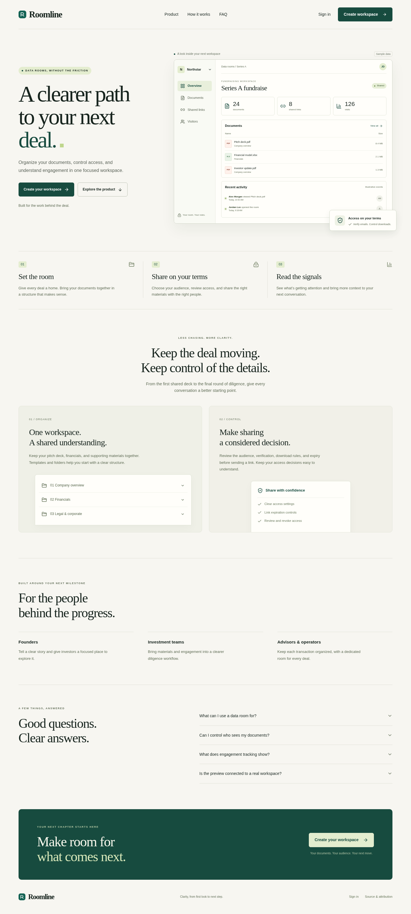

# Roomline

A focused workspace for the work behind the deal: organize documents, review sharing, and understand viewer engagement.

Roomline is an independent development fork of [Papermark](https://github.com/mfts/papermark). The initial brand and UX release adds an editorial marketing homepage, a sample interactive product preview, consistent auth and app identity, clearer room summaries, recoverable room creation, and practical next steps in the room overview.



## Run locally

Requires Node.js **24 or newer**. The marketing homepage and auth UI can render without a connected database. Real registration, login email delivery, uploads, rooms, billing, analytics, and background processing require their configured services.

```sh
npm ci
cp .env.example .env.local
# Set a unique NEXTAUTH_SECRET and your own public URLs.
# Configure service credentials through your deployment's secret settings.
npm run dev
```

Open [localhost:3000](http://localhost:3000). The homepage preview uses labeled sample data; it does not create or expose live rooms. `/login` and `/register` render the account entry screens.

**This checkout is not production-ready.** The original repository references missing source modules and has existing type errors. See [launch requirements](docs/roomline/LAUNCH.md) for the concrete blockers, configuration, and verification limits.

## Customize the business

- Identity and public URLs: [lib/brand.ts](lib/brand.ts).
- Optional support and legal links: `NEXT_PUBLIC_SUPPORT_EMAIL`, `NEXT_PUBLIC_TERMS_URL`, `NEXT_PUBLIC_PRIVACY_URL`.
- Owned email sender: `EMAIL_FROM`, with optional category overrides; never use an upstream sender identity.
- Marketing design: [components/marketing](components/marketing).
- Business positioning and follow-on scope: [product direction](docs/roomline/PRODUCT.md).
- Screenshots and automated accessibility output: [artifacts](artifacts).

Roomline is a working name. Domain and trademark availability have not been verified.

## License and attribution

The upstream [AGPLv3 license](LICENSE), [enterprise commercial license](ee/LICENSE.md), and original notices remain in place. Enterprise modules, including covered data room features, have separate production licensing requirements. The redesign does not grant rights to those modules or remove AGPL obligations. Resolve the applicable entitlement or independently replace the covered functionality before production use.

The [upstream README](docs/roomline/UPSTREAM_README.md) is retained for attribution and original setup context. It contains historical Papermark links and identities, not Roomline's business contacts or endorsements.
