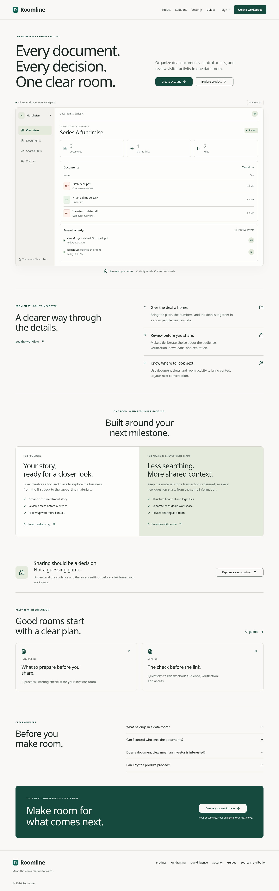

# Roomline

A focused workspace for the work behind the deal: organize documents, review sharing, and understand viewer engagement.

Roomline is an independent development fork of [Papermark](https://github.com/mfts/papermark). The brand and UX revamp adds a complete public content journey, readable interactive product preview, consistent account entry, source improvements to room summaries and creation recovery, and shared component/mobile foundations. The assessment covers 94 route templates in source and distinguishes rendered public paths from blocked authenticated work.



## Run locally

Requires Node.js **24 or newer**. The marketing homepage and auth UI can render without a connected database. Real registration, login email delivery, uploads, rooms, billing, analytics, and background processing require their configured services.

```sh
npm ci
cp .env.example .env.local
# Set a unique NEXTAUTH_SECRET and your own public URLs.
# Configure service credentials through your deployment's secret settings.
npm run dev
```

Open [localhost:3000](http://localhost:3000). Product details live at `/product`, `/security`, `/solutions/fundraising`, `/solutions/due-diligence`, and `/guides`. `/design-system` is a sample component reference, not a live workspace. The homepage preview uses labeled sample data; it does not create or expose live rooms. `/login` and `/register` render the account entry screens.

**This checkout is not production-ready.** The original repository references missing source modules and has existing type errors. See [launch requirements](docs/roomline/LAUNCH.md) for the concrete blockers, configuration, and verification limits.

## Assessment and verification

Read the [consolidated assessment](.better-design/app-review.md), [interactive evidence report](artifacts/revamp/assessment.html), [94-screen matrix](docs/roomline/revamp/SCREEN_CHECK_MATRIX.md), and [prioritized plan](docs/roomline/revamp/100X_PLAN.md).

```sh
npm run test:roomline
npm run design:test
npm run design:runtime
npm run design:check
# With the development server running and Chromium available:
npm run design:browser
npm run design:auth
npm run design:states
# This stricter check intentionally fails while launch blockers remain:
npm run design:check:release
```

The screenshot runners use `BROWSER_EXECUTABLE_PATH` or system Chromium when available; otherwise install the Playwright browser with `npx playwright install chromium`. UI auth tests mock APIs and send no emails. The evidence check validates records and source freshness; it does not grade design quality.

[AGENTS.md](AGENTS.md), [DESIGN.md](DESIGN.md), and the [34-entry reference registry](docs/roomline/revamp/REFERENCE_REGISTRY.md) define the applicable-skill workflow. They govern this repository, not every other project or editor. Reference-only frameworks were not forced into the runtime.

The [21st.dev setup](docs/roomline/revamp/21ST_SETUP.md) uses `API_KEY_21ST` from the environment. The CLI is installed and `.mcp.json` is secret-free; authenticated discovery remains pending a rotated key or browser login. No exposed key is stored in this project.

## Customize the business

- Identity and public URLs: [lib/brand.ts](lib/brand.ts).
- Optional support and legal links: `NEXT_PUBLIC_SUPPORT_EMAIL`, `NEXT_PUBLIC_TERMS_URL`, `NEXT_PUBLIC_PRIVACY_URL`.
- Owned email sender: `EMAIL_FROM`, with optional category overrides; never use an upstream sender identity.
- Marketing design: [components/marketing](components/marketing).
- Business positioning and follow-on scope: [product direction](docs/roomline/PRODUCT.md).
- Screenshots and automated accessibility output: [artifacts](artifacts).

Roomline is a working name. Domain and trademark availability have not been verified.

## License and attribution

The upstream [AGPLv3 license](LICENSE), [enterprise commercial license](ee/LICENSE.md), and original notices remain in place. Enterprise modules, including covered data room features, have separate production licensing requirements. The redesign does not grant rights to those modules or remove AGPL obligations. Resolve the applicable entitlement or independently replace the covered functionality before production use.

The [upstream README](docs/roomline/UPSTREAM_README.md) is retained for attribution and original setup context. It contains historical Papermark links and identities, not Roomline's business contacts or endorsements.
